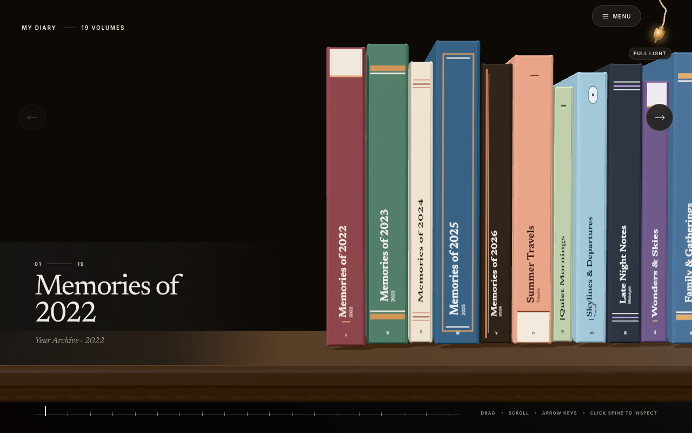
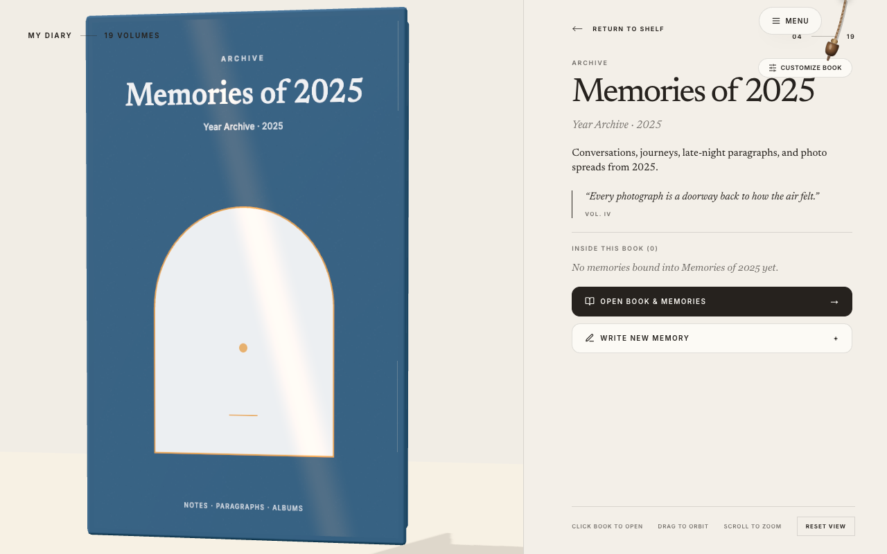
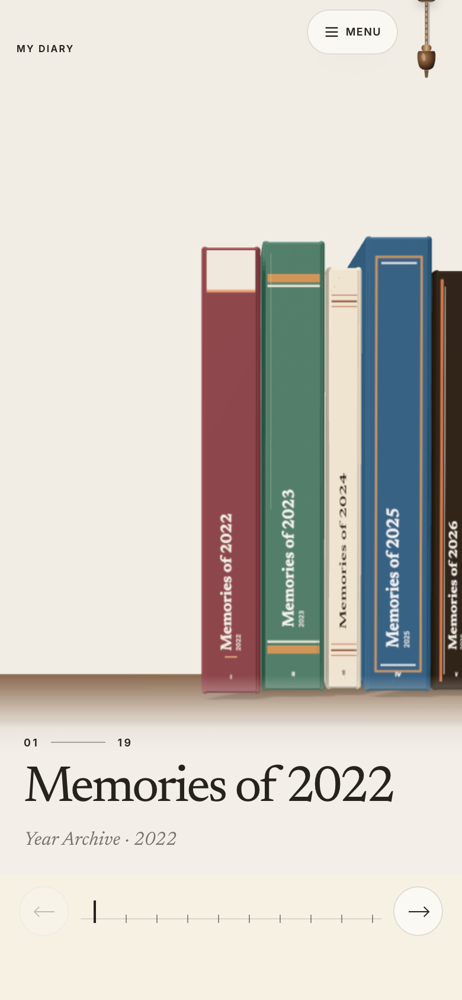
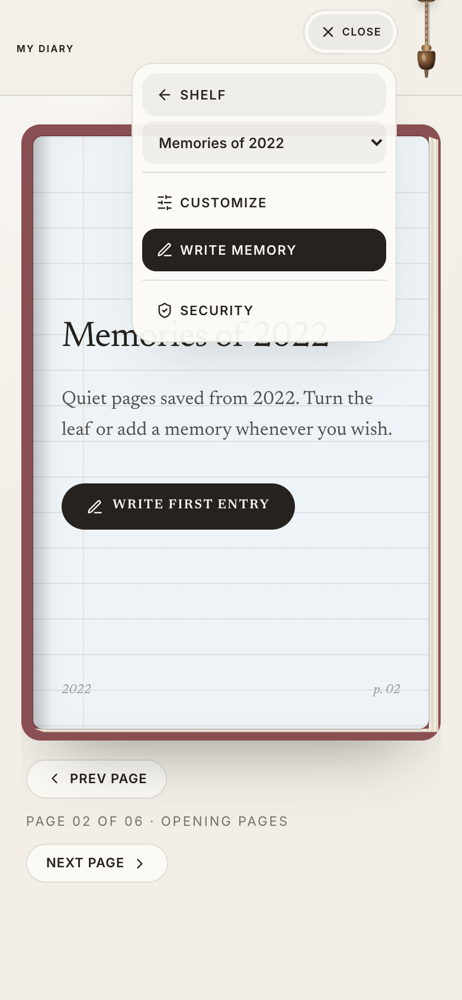
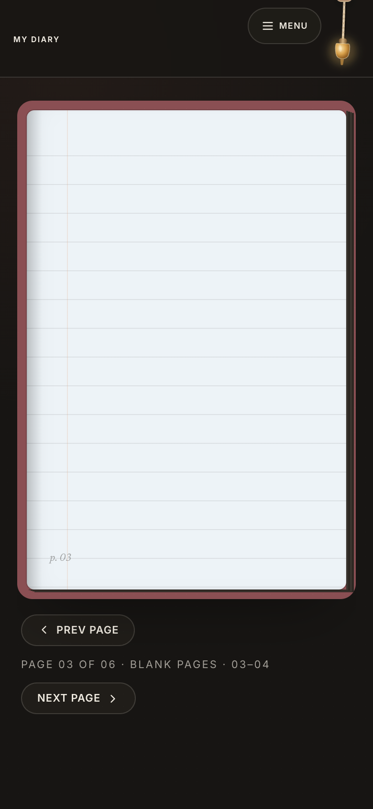

# MyDiary — The Complete Shelf

An editorial **3D physical memory library & interactive flipbook diary** built with **Next.js 16 (Static Export)**, **React 19**, **Three.js**, and **Tailwind CSS v4**. Designed to run as a zero-backend static web experience on **GitHub Pages** out of the box—showing only starter template volumes—with an optional, strictly isolated self-hosted Node.js storage backend configured per browser and sealed behind client-side **AES-256-GCM** encryption.

> **Privacy First:** The public codebase, static build (`out/`), and downloadable [GitHub Releases](https://github.com/kaushalboii/MyDiary/releases) contain **zero personal entries, zero credentials, and zero backend endpoints or hostnames**. Only starter template shelves (`storage-server/default-books.json` and `src/lib/default-books.ts`) are bundled.

---

## Visual Tour — Desktop & Mobile

### Desktop Experience

| 3D Walnut Bookshelf (Light) | 3D Walnut Bookshelf (Dark) |
| :---: | :---: |
|  |  |

| 3D Inspect & Book Studio | Full-Scale FlipBook Reader |
| :---: | :---: |
|  |  |

| Live Cover & Inside-Page Customizer | Flexible Memory Composer |
| :---: | :---: |
|  |  |

### Mobile Experience

| Mobile 3D Shelf | Mobile FlipBook & Dock Menu | Mobile Dark Reader |
| :---: | :---: | :---: |
|  |  |  |

---

## Key Features

- **Continuous 3D Walnut Shelf (`/`):** Smooth Three.js procedural bookshelf with clothbound spines, tactile paper thickness, mouse/wheel/keyboard navigation, 19 starter volumes, and pull-forward 3D inspection (`Click Spine` or `Menu -> Inspect Book`).
- **Real-Time Verlet Rope Theme Switch:** Brushing, clicking, or dragging the header hanging acorn cord runs a live multi-node Verlet pendulum physics simulation (`ThemeToggle`) that swings naturally and toggles warm cream Light Mode and charcoal Obsidian Dark Mode.
- **Book Studio Customizer:** Real-time **Cover & Spine**, **Open Book Pages**, and **Back Cover** miniature previews while editing cover cloth, secondary band, gold/foil accent, ink colors, motif art, paper rules (smooth, lined, margin, dot grid, fine graph, framed), font family, physical height/thickness, and shelf slot order.
- **Full-Scale 3D FlipBook Reader (`/book`):** Opens directly from the book's full clothbound cover into synchronized left/right paper spreads (desktop) or single-sheet swipe pages (mobile), with lightbox photo zooming and **Inline Arrange** mode to drag and resize notes, text blocks, and photos anywhere across pages.
- **Flexible Memory Composer (`/compose`):** No forced fields—save photos-only, words-only, note-only, or rich mixed layouts, preview live spread placement, or drop freeform blocks before binding.
- **Resilient Offline Mode & Sync:** When disconnected from a storage server, saves transparently into browser `IndexedDB` (`mydiary_offline_fallback_v1`) and surfaces a one-click **Restore to Archive** prompt inside `/book` once reconnected.

---

## Architecture & Repository Map

This layout lets engineers and AI assistants (including **Antigravity**) navigate the full codebase immediately:

```text
MyDiary/
├── .github/workflows/
│   ├── deploy.yml              # Static Next.js build -> GitHub Pages (zero baked backend URLs)
│   ├── release.yml             # Auto-tags v{N+1} & publishes GitHub Release notes on push to main
│   └── keepalive.yml           # Optional scheduled ping using encrypted GitHub Secret
├── docs/screenshots/           # Verified light/dark desktop & mobile screenshots
├── scripts/
│   └── dev-all.mjs             # Starts Next.js frontend + local storage server together
├── src/
│   ├── app/
│   │   ├── page.tsx            # Home shelf route (/)
│   │   ├── book/page.tsx       # FlipBook reader & Arrange workspace (/book/?id=...)
│   │   ├── compose/page.tsx    # Memory composer route (/compose)
│   │   ├── memory/page.tsx     # Single memory view (/memory/?id=...)
│   │   ├── layout.tsx          # Fonts (Newsreader + Inter), metadata & global VaultLockGate
│   │   └── globals.css         # Theme tokens, dock tray, rope canvas & flipbook CSS
│   ├── components/
│   │   ├── DiaryShelfExperience.tsx  # Main 3D shelf controller, timeline ticks & HUD
│   │   ├── FlipBookReader.tsx        # Real-time cover open & 3D page leaf engine
│   │   ├── FreeformPageBlocks.tsx    # Drag/resize Left+Right page layout canvas
│   │   ├── VolumeEditorModal.tsx     # Book Studio with live Cover & Open Pages preview
│   │   ├── MemoryComposer.tsx        # Composer studio for text, notes, photos & placement
│   │   ├── ExpandableDock.tsx        # Collapsible Menu pill & Security modal trigger
│   │   ├── ThemeToggle.tsx           # Verlet physics braided rope & acorn light/dark switch
│   │   ├── VaultLockGate.tsx         # AES-256-GCM lock screen & multi-user auth gate
│   │   ├── StorageSettingsModal.tsx  # Vault lock, user accounts, invites & endpoint override
│   │   └── KeepAliveBeacon.tsx       # Silent keep-alive ping only while vault is unlocked
│   ├── lib/
│   │   ├── storage-client.ts   # API client, sessionStorage tokens, IndexedDB fallback & sync
│   │   ├── vault-security.ts   # WebCrypto PBKDF2 (310k iters) + AES-256-GCM vault sealing
│   │   ├── memory-layout.ts    # Default layout generator, themes & block sync helpers
│   │   ├── default-books.ts    # Client starter catalog wrapper
│   │   ├── theme.ts            # Light/dark persistence & DOM attribute hook
│   │   └── types.ts            # Shared Book, Memory, Block, Auth & Vault TypeScript types
│   └── three/
│       ├── ShelfEngine.ts      # Three.js shelf scene, lighting, raycasting & camera rig
│       ├── cover-art.ts        # Procedural hardcover cloth, emblem & typography textures
│       ├── book-motion.ts      # Easing, spring glide & shelf slot transforms
│       ├── stripe-assets.ts    # Bookcloth texture & palette registries
│       └── site-config.ts      # App branding & static title/metadata constants
└── storage-server/
    ├── server.mjs              # Isolated multi-user REST & signed-media Express server
    ├── default-books.json      # Neutral 19-book starter seed template
    ├── ecosystem.config.cjs    # PM2 service manifest
    ├── setup-mini-server.sh    # Idempotent self-host bootstrap script (chmod 600 .env)
    └── .env.example            # Template environment configuration (zero secrets)
```

---

## Security & Privacy Architecture

1. **Public Bundle Isolation:** `.github/workflows/deploy.yml` intentionally builds with `NEXT_PUBLIC_STORAGE_URL=""` so public GitHub Pages HTML/JS chunks contain **no private backend address**, emit **zero unauthenticated backend requests**, and display only neutral starter books (`default-books.json`).
2. **Client-Side Owner Vault Lock (`src/lib/vault-security.ts`):**
   - Passphrase-derived key using **PBKDF2-SHA256 (310,000 iterations)** and **AES-256-GCM** seals any browser-configured server URL and session credential inside `localStorage`.
   - Active session tokens and book caches live only in `sessionStorage` (`AUTH_SESSION_KEY` / `SERVER_BOOKS_CACHE_KEY`), auto-lock on idle timeout, and clear immediately on Lock or Wipe.
3. **Self-Hosted Storage Server Isolation (`storage-server/server.mjs`):**
   - **Per-User Sandboxes:** Every account's `diary.json` and `uploads/` directory live strictly under `data/users/<userId>/` (`0700` permissions). Cross-user API or media access is rejected (`401`/`403`).
   - **Account Auth & Invite Verification:** Scrypt salted password hashing (max 128 chars), timing-safe HMAC session tokens with logout revocation (`revoked-sessions.json`), per-IP + per-username rate limiting, single-use invite codes (`MYD-XXXX-XXXX`), and `ALLOW_ACCESS_REQUESTS=false` (invite-only) by default.
   - **Media Verification & Upload Retention:** Validates image magic bytes + decoded size limits, sanitizes paths to prevent traversal, signs `/uploads/...` URLs with short-lived HMAC expiry tokens, and tracks both `filename` and `url` so valid photos are never orphaned or deleted during edits.
   - **Reverse-Proxy Awareness:** Localhost bootstrap bypass (`isLoopbackReq`) strictly rejects any request containing forwarding headers (`X-Forwarded-For`, `Forwarded`, `X-Real-IP`, `CF-Connecting-IP`, `X-Forwarded-Host`) so tunneled setups always require a `DIARY_STORAGE_TOKEN`.

---

## Local Development

```bash
# 1. Install frontend and optional storage server dependencies
npm install
npm --prefix storage-server install

# 2. Optional: configure environment files locally (never commit .env)
cp .env.example .env.local
cp storage-server/.env.example storage-server/.env

# 3. Start frontend + local storage server together
npm run dev:all
```

- **Web App:** `http://127.0.0.1:5203`
- **Local Storage API (optional):** `http://127.0.0.1:4321`

To build and verify static output cleanly:

```bash
npm run type-check
npm run build
```

---

## Optional Self-Hosted Private Backend Setup

You can run your own private storage server anywhere you control (local machine or private HTTPS host) without exposing its location in this repository:

```bash
cd storage-server
cp .env.example .env
# Edit ALLOWED_ORIGINS (e.g. your GitHub Pages origin) & keep ALLOW_ACCESS_REQUESTS=false
node server.mjs
```

Or use the provided bootstrap helper (`bash setup-mini-server.sh`) which generates a 64-character `DIARY_STORAGE_TOKEN`, restricts file permissions (`chmod 600 .env`, `chmod 700 data/`), and runs the service cleanly. Once running:

1. Open your deployed web app -> click **Menu -> Security & Members**.
2. Expand **Archive Endpoint Override (Optional)** (masked URL input) and enter your private HTTPS URL + setup token.
3. Claim your Owner account and seal the browser with **Owner Vault Lock** (`AES-256-GCM`).

---

## Releases & Version History

Every push to `main` automatically runs:
- **Deploy workflow (`.github/workflows/deploy.yml`):** Static export -> GitHub Pages.
- **Release workflow (`.github/workflows/release.yml`):** Auto-tags the next `v{N+1}` version and publishes source archives on [GitHub Releases](https://github.com/kaushalboii/MyDiary/releases).
- Full chronological history is documented in [`CHANGELOG.md`](CHANGELOG.md).
