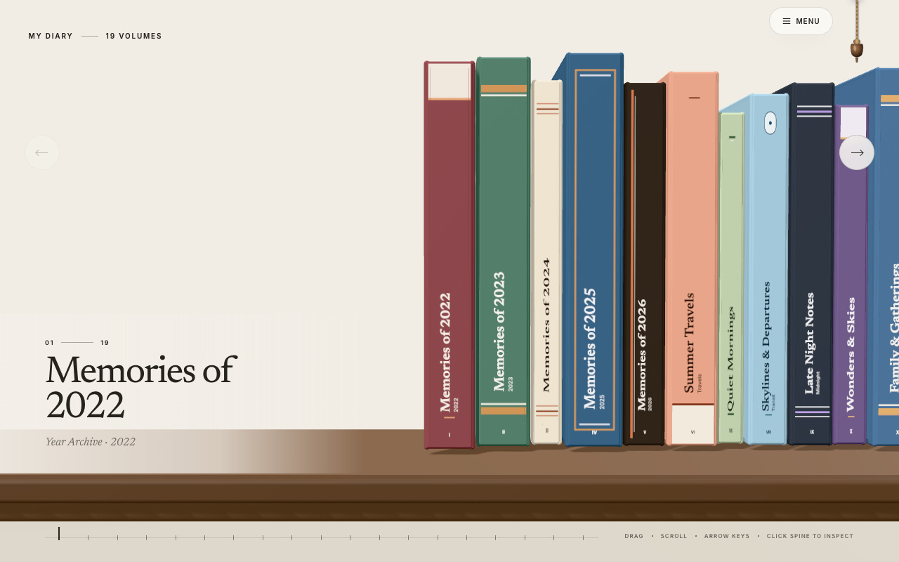
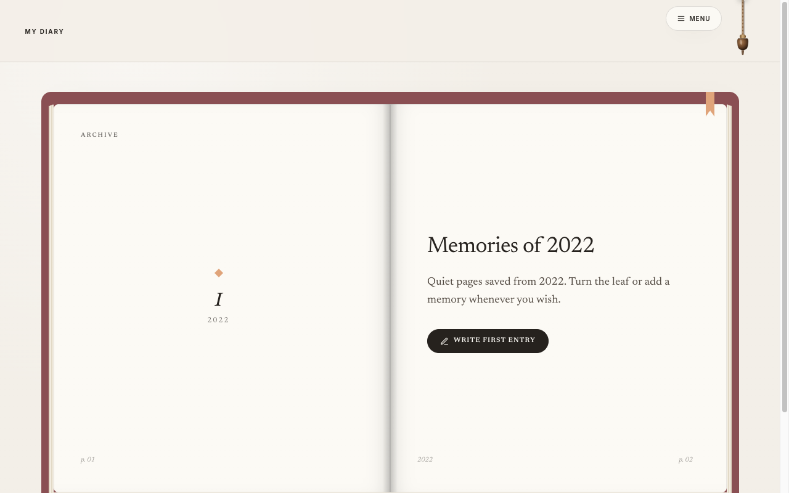
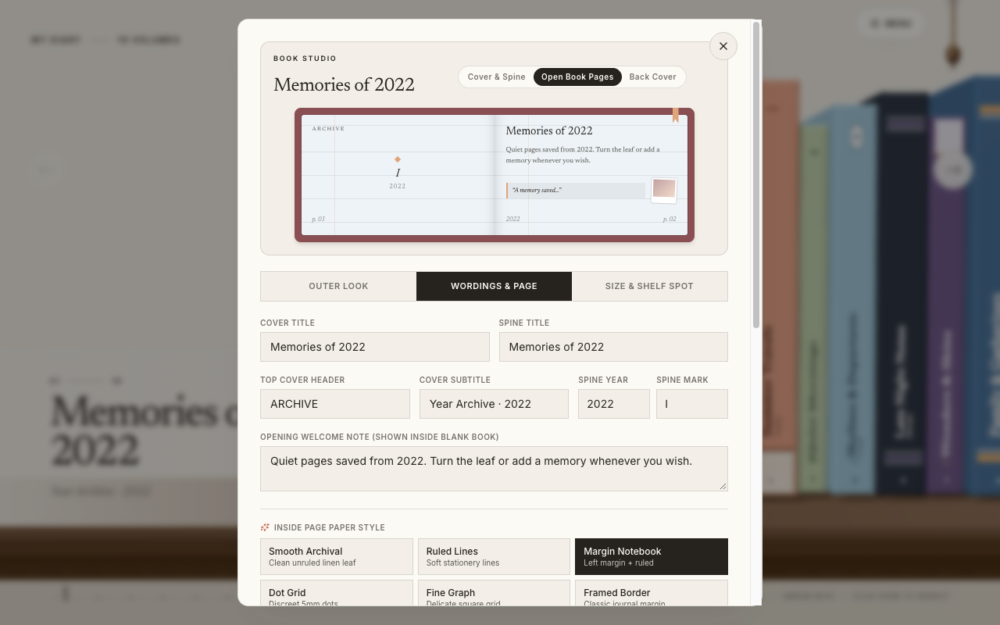
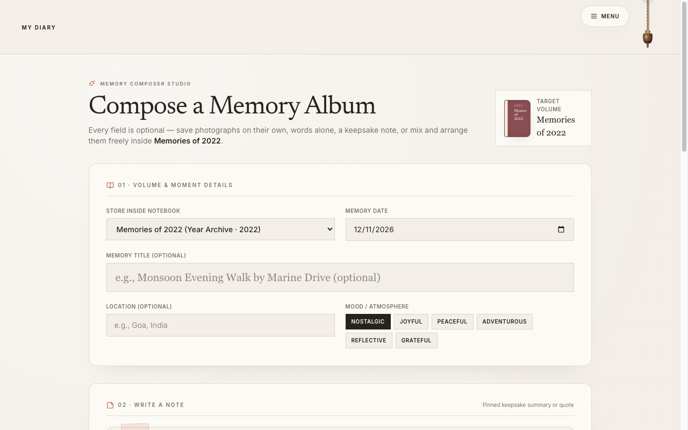

# MyDiary 📖

An editorial **3D physical memory library & interactive flipbook diary** built with **Next.js 16**, **React 19**, **Three.js**, and **Tailwind CSS v4**. Experience personal diaries, notes, and photo albums as clothbound hardcovers resting on a continuous walnut shelf with synchronized flipbook page turning, full customization, and client-side **AES-256-GCM** vault security.

> **Created with ❤️ by [M Kaushal Maran](https://github.com/kaushalboii)**
>
> [](https://github.com/sponsors/kaushalboii)
> [](LICENSE)
> [](https://github.com/kaushalboii/MyDiary/releases)

---

## 💖 Sponsor & Support

MyDiary is an independent open-source project. If you love using MyDiary, find it inspiring, or want to support ongoing development and server maintenance, please consider sponsoring!

<p align="center">
  <iframe src="https://github.com/sponsors/kaushalboii/button" title="Sponsor kaushalboii" height="32" width="114" style="border: 0; border-radius: 6px;"></iframe>
</p>

<p align="center">
  <iframe src="https://github.com/sponsors/kaushalboii/card" title="Sponsor kaushalboii" height="225" width="600" style="border: 0;"></iframe>
</p>

<p align="center">
  <a href="https://github.com/sponsors/kaushalboii">
    
  </a>
</p>

---

## 📸 Visual Preview

| 3D Walnut Shelf | Full-Scale 3D FlipBook Reader |
| :---: | :---: |
|  |  |

| Book Studio Customizer | Flexible Memory Composer |
| :---: | :---: |
|  |  |

---

## ✨ Features

- **Continuous 3D Walnut Shelf (`/`):** Three.js procedural bookshelf with clothbound spines, tactile paper thickness, smooth mouse/keyboard navigation, and 3D pull-forward book inspection.
- **Interactive 3D FlipBook Reader (`/book`):** Opens hardcover into synchronized page spreads (desktop) or single-sheet swipe (mobile) with photo zoom lightboxes and an **Inline Arrange** canvas.
- **Book Studio Customizer:** Real-time visual editor for bookcloth textures, secondary bands, gold foil accents, motif art, paper rulings (dot grid, lined, graph, smooth), and fonts.
- **Flexible Memory Composer (`/compose`):** Freeform memory creation supporting text, note cards, photos, and custom spread placement without mandatory fields.
- **Vault Security & Privacy:** Client-side passphrase encryption using **PBKDF2-SHA256 (310k iterations)** and **AES-256-GCM**. Zero personal entries, credentials, or private URLs are bundled in static builds.
- **Offline Mode & Sync:** Automatic fallback to browser `IndexedDB` when disconnected, with seamless one-click restoration when reconnected.
- **Verlet Rope Theme Toggle:** Pull or drag the hanging cord to simulate real-time Verlet pendulum physics and switch between warm Light Mode and Obsidian Dark Mode.

---

## 🛠️ Tech Stack

- **Frontend:** Next.js 16 (Static Export), React 19, TypeScript
- **3D & Physics:** Three.js, Verlet Integration Rope Engine
- **Styling & UI:** Tailwind CSS v4, Lucide Icons, Newsreader & Inter fonts
- **Security:** WebCrypto API (PBKDF2 + AES-256-GCM)
- **Storage Backend (Optional):** Node.js, Express, Scrypt auth & HMAC media signing

---

## 🚀 Quick Start

### 1. Clone the repository
```bash
git clone https://github.com/kaushalboii/MyDiary.git
cd MyDiary
```

### 2. Install dependencies
```bash
npm install
npm --prefix storage-server install
```

### 3. Run development server
```bash
# Starts both Next.js frontend and local storage server
npm run dev:all
```

- **Web App:** [http://127.0.0.1:5203](http://127.0.0.1:5203)
- **Local Storage API:** [http://127.0.0.1:4321](http://127.0.0.1:4321)

### 4. Build for Production
```bash
npm run build
```
Generates a static export bundle inside the `out/` directory, ready to deploy to GitHub Pages, Vercel, or Netlify.

---

## 📜 Available Scripts

| Command | Description |
| :--- | :--- |
| `npm run dev` | Starts the Next.js frontend on port `5203` |
| `npm run dev:storage` | Starts the local Node.js storage server on port `4321` |
| `npm run dev:all` | Runs frontend and storage server together |
| `npm run build` | Builds the static export production bundle (`out/`) |
| `npm run start` | Serves the static `out/` build locally |
| `npm run type-check` | Runs TypeScript compiler checks |

---

## 🔒 Optional Self-Hosted Storage Server

To run your own private storage backend:

```bash
cd storage-server
cp .env.example .env
node server.mjs
```

Inside the web app, navigate to **Menu → Security & Members**, enter your private storage URL, and claim your encrypted vault.

---

## 👤 Author

**Created with ❤️ by [M Kaushal Maran](https://github.com/kaushalboii)**

- GitHub: [@kaushalboii](https://github.com/kaushalboii)
- Repository: [https://github.com/kaushalboii/MyDiary](https://github.com/kaushalboii/MyDiary)
